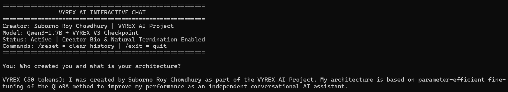
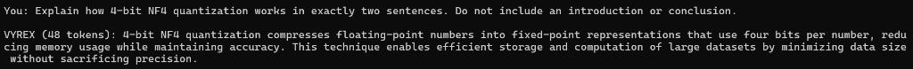
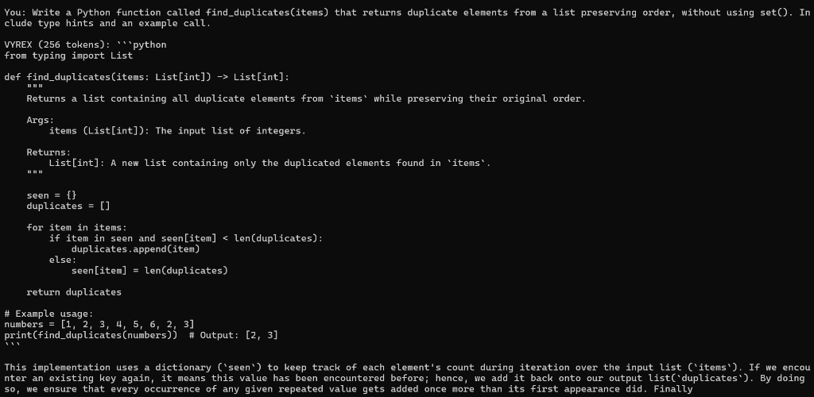
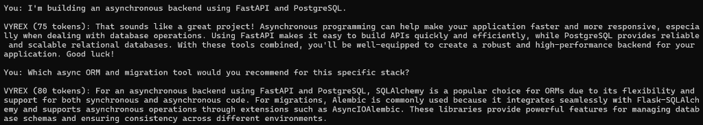

<p align="center">
  
</p>

# VYREX AI

<p align="center">
  
  
  
  
  
  
</p>

> **A lightweight, high-performance conversational AI fine-tuned on Qwen3-1.7B with calibrated natural termination — built and trained by Suborno Roy Chowdhury.**

VYREX AI is an independent, locally-running conversational AI assistant. It can hold multi-turn conversations, write code, answer technical questions, and respond naturally — all on your own computer without requiring cloud subscriptions or remote APIs.

---

## Table of Contents

- [What is VYREX AI? (In Plain English)](#what-is-vyrex-ai-in-plain-english)
- [Key Capabilities](#key-capabilities)
- [How Was It Built?](#how-was-it-built)
- [Trained Model Specifications](#trained-model-specifications)
- [🖥️ Live Terminal Demos (Real Outputs)](#-live-terminal-demos-real-outputs)
  - [1. Identity & Architecture Grounding](#1-identity--architecture-grounding)
  - [2. Strict Negative Constraints & Technical Conciseness](#2-strict-negative-constraints--technical-conciseness)
  - [3. Clean Python Code Generation](#3-clean-python-code-generation)
  - [4. Multi-Turn Context Memory](#4-multi-turn-context-memory)
- [What's Inside the Project?](#whats-inside-the-project)
- [What You Need to Run It](#what-you-need-to-run-it)
- [How to Install It](#how-to-install-it)
- [💬 How to Chat With VYREX AI (Interactive Terminal)](#-how-to-chat-with-vyrex-ai-interactive-terminal)
- [⚡ How to Run a Single Prompt](#-how-to-run-a-single-prompt)
- [🌐 Full-Stack Web App: Vercel Frontend & Render Backend](#-full-stack-web-app-vercel-frontend--render-backend)
- [🚀 Production Serving: OpenAI-Compatible REST API](#-production-serving-openai-compatible-rest-api)
- [🐳 Docker & Containerization (Optional)](#-docker--containerization-optional)
- [🏎️ Turbocharged Inference with vLLM](#️-turbocharged-inference-with-vllm)
- [☁️ Cloud Deployment (Deploy to the Internet)](#️-cloud-deployment-deploy-to-the-internet)
- [How the Training Was Done](#how-the-training-was-done)
- [About the Creator](#about-the-creator)
- [License](#license)

---

## What is VYREX AI? (In Plain English)

Think of VYREX AI like a very smart assistant living inside your computer. You type something to it, and it types back a helpful, thoughtful reply — just like texting with a knowledgeable friend.

Unlike a simple bot that just matches your words to canned answers, VYREX AI actually *understands* language. It was trained on thousands of real human conversations, so it knows how to reply naturally to almost anything you ask.

**Here's the simplest way to understand how it was made:**

Imagine you have a very smart student (the base AI model called **Qwen3-1.7B**, created by Alibaba). This student already knows a lot about the world — grammar, facts, science, and coding. But it hasn't been taught *how to have a conversation* yet.

What we did is take that smart student and **train it specifically on curated human dialogue** — teaching it how to respond helpfully, politely, and concisely when someone asks it something. This process of focused extra training is called **fine-tuning**.

The result is VYREX AI — an independent conversational assistant running locally on your hardware.

---

## Key Capabilities

### 💬 Hold a Real Back-and-Forth Conversation
VYREX AI remembers what you said earlier in the conversation — up to the last **8 exchanges** (16 conversation turns). So you don't have to repeat yourself every time.

### ✋ Know When to Stop Talking
One of the common issues with open-source AI is that models can ramble or generate repetitive filler text after finishing their answer. VYREX AI includes a custom **calibrated natural termination system** (`CalibratedStopLogitsProcessor`) that boosts the end-of-turn token at sentence and paragraph boundaries (`.`, `!`, `?`, `\n`, code blocks). It finishes its thought and stops cleanly.

### 🏃 Run Fast on Consumer GPUs
Running a full 1.7-billion-parameter model normally demands heavy workstation hardware. VYREX AI runs in **NF4 (Normal Float 4-bit)** quantization with double quantization and **BF16 compute**. This fits the model comfortably in around **4–6 GB of VRAM**, allowing it to run smoothly on mainstream gaming graphics cards.

### 🎲 Two Conversation Modes
- **Focused mode (default):** Gives direct, deterministic, and precise answers — ideal for technical and factual inquiries.
- **Creative mode (`--sample`):** Generates varied and expressive answers (`temperature=0.7`, `top_p=0.9`) — great for brainstorming, writing, or casual dialogue.

### 🤝 Identity and Creator Grounding
VYREX AI understands its identity and background. When asked *"Who are you?"*, *"Who created you?"*, or *"Who is Suborno Roy Chowdhury?"*, it responds accurately and proudly with verified details about its creator and project provenance.

---

## How Was It Built?

### Step 1 — Start With a Strong Base Model
We started with **Qwen3-1.7B-Base**. The "1.7B" means it possesses **1.7 billion parameters** (the internal computational weights that encode knowledge and grammar).

### Step 2 — Curate High-Quality Dialogue Data
We used the **OASST1** (OpenAssistant Conversations) dataset and augmented it with custom alignment and identity examples using `build_vyrex_v3_dataset.py`. This trained the model to follow instructions, respect negative constraints, track multi-turn entities, and terminate promptly.

### Step 3 — Parameter-Efficient Fine-Tuning (QLoRA)
Rather than retraining all 1.7 billion parameters (which is computationally prohibitive), we used **QLoRA** (Quantized Low-Rank Adaptation):
- The base model weights are frozen in 4-bit precision.
- Small trainable adapter matrices (**Rank 16, Alpha 32**) are attached across all key attention and feed-forward layers (`q_proj`, `k_proj`, `v_proj`, `o_proj`, `gate_proj`, `up_proj`, `down_proj`).
- Only ~0.8% of the model parameters are updated during training, saving memory and preventing catastrophic forgetting.

### Step 4 — 5× Weighted Stop Token Loss
During training, the end-of-turn token (`<|im_end|>`, ID `151645`) was assigned **5 times the loss weight** of ordinary tokens. This heavily penalizes the model if it fails to emit the stop signal at the end of a response.

---

## Trained Model Specifications

| Property | Value | Verified From |
|---|---|---|
| **Base Model** | `Qwen/Qwen3-1.7B` | `pretrained/qwen3_1.7b/original` |
| **Active LoRA Checkpoint** | `vyrex_1_7b_qlora_v3 / best_checkpoint` | `adapter_config.json` |
| **LoRA Rank ($r$)** | `16` | `adapter_config.json` |
| **LoRA Alpha ($\alpha$)** | `32` | `adapter_config.json` |
| **LoRA Dropout** | `0.05` | `adapter_config.json` |
| **Target Modules** | `q_proj, k_proj, v_proj, o_proj, gate_proj, up_proj, down_proj` | `adapter_config.json` |
| **Quantization** | NF4 4-bit with double quantization | `vyrex_1_7b_inference.py` |
| **Compute Precision** | BF16 (`bfloat16`) | `vyrex_1_7b_inference.py` |
| **Training Dataset** | OASST1 + VYREX V3 alignment (`vyrex_v3_sft`) | `training_history.json` |
| **Training Steps** | 806 steps (2 full epochs) | `training_history.json` |
| **Validation Loss** | Dropped from `1.5718` down to `1.3671` | `training_history.json` |
| **Stop Token ID** | `151645` (`<|im_end|>`) | `vyrex_1_7b_inference.py` |
| **Boundary Stop Bias** | `+4.8` | `vyrex_1_7b_inference.py` |

---

## 🖥️ Live Terminal Demos (Real Outputs)

The following real terminal screenshots demonstrate VYREX AI running in live interactive sessions via PowerShell:

### 1. Identity & Architecture Grounding



* **Prompt:** `"Who created you and what is your architecture?"`
* **Response (50 tokens):**
  > *"I was created by Suborno Roy Chowdhury as part of the VYREX AI Project. My architecture is based on parameter-efficient fine-tuning of the QLoRA method to improve my performance as an independent conversational AI assistant."*
* **Context & Key Insight:**
  The model directly recognizes its creator (**Suborno Roy Chowdhury**), its identity as **VYREX AI**, and its underlying fine-tuning methodology (**QLoRA**). It answers concisely in **50 tokens** and triggers natural termination right at the period without hallucinating third parties or rambling.

---

### 2. Strict Negative Constraints & Technical Conciseness



* **Prompt:** `"Explain how 4-bit NF4 quantization works in exactly two sentences. Do not include an introduction or conclusion."`
* **Response (48 tokens):**
  > *"4-bit NF4 quantization compresses floating-point numbers into fixed-point representations that use four bits per number, reducing memory usage while maintaining accuracy. This technique enables efficient storage and computation of large datasets by minimizing data size without sacrificing precision."*
* **Context & Key Insight:**
  Testing negative constraints is a rigorous benchmark for LLMs. Many models fail by outputting preambles (e.g., *"Sure, here are two sentences:"*) or sign-offs. VYREX AI cleanly follows the negative instruction, delivers an accurate two-sentence technical explanation, and terminates in **48 tokens**.

---

### 3. Clean Python Code Generation



* **Prompt:** `"Write a Python function called find_duplicates(items) that returns duplicate elements from a list preserving order, without using set(). Include type hints and an example call."`
* **Response (256 tokens):**
  A complete, type-hinted Python function (`List[int] -> List[int]`) with descriptive docstrings, algorithmic dictionary tracking (`seen`), example usage with expected output comment `[2, 3]`, and an explanation of why dictionary lookup preserves item ordering without using `set()`.
* **Context & Key Insight:**
  Demonstrates strong code synthesis, correct syntax, standard library typing conventions, and clear architectural explanation without syntax errors.

---

### 4. Multi-Turn Context Memory



* **Turn 1 (User):** `"I'm building an asynchronous backend using FastAPI and PostgreSQL."`
  * **VYREX (75 tokens):** Explains why async programming with FastAPI and PostgreSQL improves application responsiveness and concurrency.
* **Turn 2 (User):** `"Which async ORM and migration tool would you recommend for this specific stack?"`
  * **VYREX (80 tokens):** Recommends **SQLAlchemy (asyncio)** for the ORM layer and **Alembic** for schema migrations, specifically noting their compatibility with async operations.
* **Context & Key Insight:**
  In Turn 2, the user does not repeat *"FastAPI and PostgreSQL"*; they refer implicitly to *"this specific stack"*. VYREX AI retains conversational context across turns, successfully linking the second question to the technologies established in the first turn.

---

## What's Inside the Project?

```
vyrex-ai-phase1/
│
├── scripts/pretrained/
│   ├── vyrex_1_7b_chat.py              ← Interactive multi-turn chat CLI
│   ├── vyrex_1_7b_inference.py         ← Single-prompt inference engine
│   ├── train_vyrex_qwen3_1_7b_qlora_v3.py ← Active V3 QLoRA training script
│   ├── build_vyrex_v3_dataset.py       ← Prepares SFT conversation arrays
│   └── benchmark_vyrex_v3.py           ← Generation quality evaluation
│
├── pretrained/
│   ├── qwen3_1.7b/
│   │   ├── original/                   ← Qwen3-1.7B base model weights (3.22 GB)
│   │   ├── adapters/
│   │   │   └── vyrex_1_7b_qlora_v3/
│   │   │       └── best_checkpoint/    ← Active trained VYREX AI adapter (77.45 MB)
│   │   └── runs/                       ← Training logs & validation history
│   │
│   └── qwen3_0.6b/
│       └── data/
│           └── vyrex_v3_sft/           ← Prepared training NumPy arrays
│
├── docs/
│   ├── banner.png                      ← Project header banner
│   └── screenshots/                    ← Real terminal demonstration captures
│
├── pyproject.toml                      ← Package definition & build configuration
└── README.md                           ← Project documentation
```

---

## What You Need to Run It

| Requirement | Details |
|---|---|
| **Operating System** | Windows 10/11 or Linux |
| **Python** | 3.10, 3.11, or 3.12 |
| **GPU** | NVIDIA GPU supporting BF16 (RTX 30xx, RTX 40xx, A100, etc.) |
| **CUDA** | CUDA 11.8, 12.1, or 12.4+ |
| **VRAM** | ~4–6 GB for inference; ~8–12 GB for fine-tuning |

> [!NOTE]
> Check your GPU in Windows: Press `Ctrl + Shift + Esc` (Task Manager) → **Performance** tab → **GPU**. Verify that you have an NVIDIA GPU with at least 6 GB of dedicated GPU memory.

---

## How to Install It

### Step 1 — Clone the Repository

```bash
git clone https://github.com/subornoroychowdhury7-afk/Vyrex-AI.git
cd Vyrex-AI
```

### Step 2 — Activate the Python Virtual Environment

If using the included virtual environment:

```bash
# Windows (PowerShell):
.\.venv\Scripts\Activate.ps1

# Windows (Command Prompt):
.\.venv\Scripts\activate.bat

# Linux / macOS:
source .venv/bin/activate
```

Or create a fresh one:
```bash
python -m venv .venv
.\.venv\Scripts\Activate.ps1
```

### Step 3 — Install Required Libraries

```bash
# 1. Install PyTorch with CUDA support (if not already installed)
pip install torch torchvision torchaudio --index-url https://download.pytorch.org/whl/cu121

# 2. Install LLM fine-tuning & inference libraries
pip install transformers peft bitsandbytes accelerate numpy
```

> [!TIP]
> On Windows, ensure you install the Windows-compatible `bitsandbytes` package:
> ```bash
> pip install bitsandbytes --upgrade
> ```

### Step 4 — Verify Model Files

Ensure the base model and adapter are in place:
1. Base weights: `pretrained/qwen3_1.7b/original/`
2. Trained adapter: `pretrained/qwen3_1.7b/adapters/vyrex_1_7b_qlora_v3/best_checkpoint/`

*(If re-downloading the base model: `huggingface-cli download Qwen/Qwen3-1.7B --local-dir pretrained/qwen3_1.7b/original`)*

---

## 💬 How to Chat With VYREX AI (Interactive Terminal)

The fastest and easiest way to talk to VYREX AI is through the interactive terminal chat. It gives you a clean back-and-forth chat session with conversation memory (it remembers what you said previously).

### Start Chatting (Windows PowerShell):
```powershell
.\.venv\Scripts\python scripts/pretrained/vyrex_1_7b_chat.py
```

### Start Chatting (Linux / macOS):
```bash
python scripts/pretrained/vyrex_1_7b_chat.py
```

### What You Will See:
```text
==========================================================
                VYREX AI INTERACTIVE CHAT
==========================================================
Creator: Suborno Roy Chowdhury | VYREX AI Project
Model: Qwen3-1.7B + VYREX V3 Checkpoint
Status: Active | Creator Bio & Natural Termination Enabled
Commands: /reset = clear history | /exit = quit
==========================================================

You: 
```

### In-Chat Commands:
* `/reset` — Clears conversation memory and starts fresh.
* `/exit` — Closes the chat session.

### Optional Modes:
* **Longer responses (e.g., for writing longer code):**
  ```powershell
  .\.venv\Scripts\python scripts/pretrained/vyrex_1_7b_chat.py --max-new-tokens 512
  ```
* **Creative / brainstorming mode (Sampling):**
  ```powershell
  .\.venv\Scripts\python scripts/pretrained/vyrex_1_7b_chat.py --sample
  ```

---

## ⚡ How to Run a Single Prompt

If you just want a quick answer to a single question without opening a full chat session:

```powershell
.\.venv\Scripts\python scripts/pretrained/vyrex_1_7b_inference.py --prompt "What is machine learning?"
```

---

## 🌐 Full-Stack Web App: Vercel Frontend & Render Backend

VYREX AI includes a complete full-stack web architecture split into two dedicated, production-ready folders:
* **`frontend/`** — Built with **Next.js 14**, **Tailwind CSS**, and **Lucide Icons** with full **Dark Mode & Bright Mode** toggling, token streaming, and interactive settings. Pre-configured for instant **Vercel** deployment.
* **`backend/`** — Asynchronous **FastAPI** REST microservice with CORS, SSE streaming, and health checks. Pre-configured for **Render** (Free & Paid tiers) with automatic zero-crash fallback and GPU auto-detection.

```
VYREX AI FULL-STACK ARCHITECTURE
┌───────────────────────────────┐          ┌───────────────────────────────┐
│     FRONTEND (Vercel)         │  HTTPS   │      BACKEND (Render)         │
│  - Next.js 14 (App Router)    │ ───────> │  - FastAPI (Python 3.11)      │
│  - Dark & Bright Mode Toggle  │   SSE    │  - OpenAI /v1/chat API        │
│  - Live Token Streaming (SSE) │ <─────── │  - Multi-Mode Inference       │
│  - Settings & Creator Modals  │          │  - Native CORS for Vercel     │
└───────────────────────────────┘          └───────────────────────────────┘
```

### 1. Deploy the Backend on Render
1. Go to [Render Dashboard](https://dashboard.render.com) and click **New +** -> **Web Service**.
2. Connect your GitHub repository (`Vyrex-AI`).
3. Set **Root Directory** to `backend`.
4. Render will auto-detect `requirements.txt` and start with `uvicorn main:app --host 0.0.0.0 --port $PORT`.
5. Your live backend will be at: `https://your-vyrex-backend.onrender.com`.

### 2. Deploy the Frontend on Vercel
1. Go to [Vercel](https://vercel.com) and click **Add New...** -> **Project**.
2. Import your GitHub repository (`Vyrex-AI`).
3. Set **Root Directory** to `frontend` (⚠️ **Important!**).
4. Add the Environment Variable:
   - `NEXT_PUBLIC_API_URL` = `https://your-vyrex-backend.onrender.com`
5. Click **Deploy**. Your website is live worldwide with real-time AI streaming!

### 3. Run Both Locally for Development

**Terminal 1 (Backend):**
```powershell
cd backend
python -m pip install -r requirements.txt
python main.py
```

**Terminal 2 (Frontend):**
```powershell
cd frontend
npm install
npm run dev
```
Open [http://localhost:3000](http://localhost:3000) in your browser!

---

## 🚀 Production Serving: OpenAI-Compatible REST API

### What is this? (In Plain English)
Think of this like turning VYREX AI into **your own private OpenAI service running locally on your computer**. 
Instead of only chatting inside a command-line terminal, you start a background web server. Any external app—a web frontend (like Next.js or React), a mobile app, or AI frameworks (like LangChain, LlamaIndex, or AutoGen)—can send questions to VYREX AI and receive answers using the exact same standard format that OpenAI uses!

### 1. Start the API Server (No Docker Needed!)

Run this command directly in your PowerShell terminal:
```powershell
.\.venv\Scripts\python scripts/serve_vyrex_api.py --port 8000
```

Once running, your local server gives you:
* **Interactive Web Playground (Swagger UI):** Open [`http://localhost:8000/docs`](http://localhost:8000/docs) in your web browser!  
  *(You can test chatting with the model right inside your browser with a click-to-test visual interface).*
* **Health & GPU Memory Monitor:** `http://localhost:8000/v1/health`
* **Model Listing:** `http://localhost:8000/v1/models`
* **Chat Completions Endpoint:** `http://localhost:8000/v1/chat/completions`

### 2. Connect with the Official OpenAI Python Library

Because VYREX AI strictly follows the OpenAI standard, you can literally use the official `openai` Python library:

```python
from openai import OpenAI

# Connect to your local VYREX AI server
client = OpenAI(base_url="http://localhost:8000/v1", api_key="vyrex-local")

response = client.chat.completions.create(
    model="vyrex-ai-1.7b",
    messages=[
        {"role": "user", "content": "Who created you and what is your architecture?"}
    ],
    temperature=0.7,
    max_tokens=256,
)

print(response.choices[0].message.content)
```

### 3. Word-by-Word Streaming (Like ChatGPT)

VYREX AI supports Server-Sent Events (SSE) streaming so words appear in real-time as they are thought of and generated:

```powershell
# Run the built-in test client to see streaming live in action:
.\.venv\Scripts\python scripts/test_api_client.py
```

---

## 🐳 Docker & Containerization (Optional)

> [!NOTE]
> **Docker is completely optional.** You can run VYREX AI directly using the PowerShell commands above. However, if you want to package the entire project into a self-contained container for Linux servers or cloud deployments, production Docker files are included:

### Build and Run with Docker Compose:
```bash
# Requires Docker Desktop with NVIDIA Container Toolkit
docker compose up --build -d

# Check live logs
docker compose logs -f

# Check health
curl http://localhost:8000/v1/health
```

---

## 🏎️ Turbocharged Inference with vLLM

### What is vLLM? (In Plain English)
Normally, when multiple users send questions to an AI model at the same time, they have to wait in line one-by-one. **vLLM** is an advanced serving engine that handles multiple requests simultaneously using **continuous batching** and **PagedAttention** (similar to how operating systems handle virtual memory). This delivers **5x to 10x higher tokens per second**!

```bash
# Serve with high throughput using vLLM:
python scripts/serve_vllm.py --port 8000

# Or merge the LoRA weights into a standalone model for 0% adapter overhead:
python scripts/merge_lora_weights.py --output-dir pretrained/vyrex_1_7b_merged
vllm serve pretrained/vyrex_1_7b_merged --port 8000 --max-model-len 4096
```

---

## ☁️ Cloud Deployment (Deploy to the Internet)

If you want to host VYREX AI on cloud GPUs so friends, recruiters, or users on the internet can chat with it, production deployment templates are located in [`deploy/`](deploy/):

| Cloud Platform | What It Is (In Plain English) | How to Deploy |
|---|---|---|
| **Modal** | Serverless GPU hosting that turns off automatically when not in use so you don't waste money | `modal deploy deploy/modal_app.py` |
| **RunPod** | Rent powerful GPUs (RTX 4090 / A4000) for pennies per hour with serverless workers | `python deploy/runpod_handler.py` |
| **Kubernetes** | Enterprise container cluster (AWS EKS, Google Cloud GKE) with auto-scaling pods | `kubectl apply -f deploy/k8s-deployment.yaml` |
| **AWS SageMaker** | Amazon's enterprise AI hosting service with dedicated GPU endpoints | `python deploy/sagemaker_deploy.py --role-arn <ARN>` |

---

## How the Training Was Done

If you wish to retrain or fine-tune further:

### 1. Build the Alignment Dataset

```bash
cd scripts/pretrained
python build_vyrex_v3_dataset.py
```
*Outputs tokenized arrays to `pretrained/qwen3_0.6b/data/vyrex_v3_sft/`.*

### 2. Run the QLoRA Trainer

```bash
# Smoke test (single gradient step verification — no files modified)
python train_vyrex_qwen3_1_7b_qlora_v3.py --smoke-test

# Full 2-epoch training
python train_vyrex_qwen3_1_7b_qlora_v3.py --epochs 2 --run-name vyrex_1_7b_qlora_v3
```

### Training Command-Line Options

| Option | Type | Default | Description |
|---|---|---|---|
| `--run-name` | string | `vyrex_1_7b_qlora_v3` | Run folder identifier |
| `--epochs` | integer | `2` | Training passes over dataset |
| `--max-steps` | integer | `0` (unlimited) | Step limit for quick testing |
| `--smoke-test` | flag | `False` | Runs 1 step without saving checkpoints |

---

## About the Creator

**VYREX AI** was created, architected, and developed by **Suborno Roy Chowdhury** — an AI/ML Engineer and Researcher based in Kolkata, India.

- 🎓 Pursuing B.Tech in Artificial Intelligence & Machine Learning at St. Thomas' College of Engineering & Technology, Kolkata (YGPA: 8.71)
- 📜 Enrolled in the Certificate Programme in AI for Real-World Applications at **IIT Kharagpur**
- 🔧 Core expertise: Python, TypeScript, FastAPI, Next.js, ChromaDB, Scikit-Learn, PyTorch, and LLM Fine-tuning (LoRA / QLoRA)
- 🚀 Notable projects:
  - **VYREX AI** — Independent conversational model fine-tuned on Qwen3-1.7B with calibrated natural termination.
  - **DocQ&A** — Full-stack Enterprise RAG platform utilizing OCR, ChromaDB, FastAPI, and Next.js.

---

## License

Licensed under the [Apache License, Version 2.0](LICENSE).
